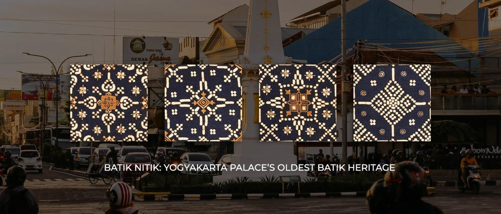
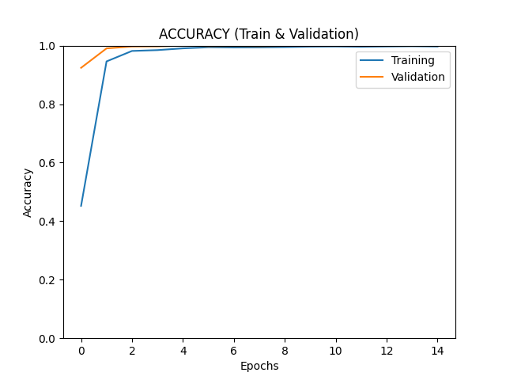
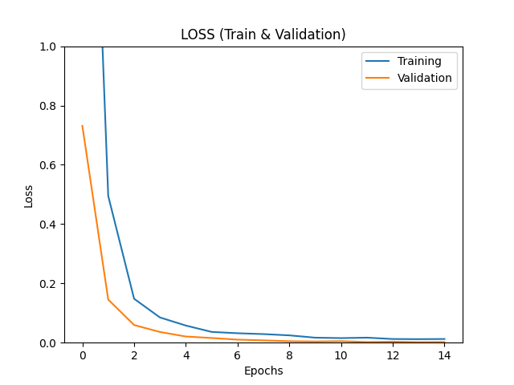
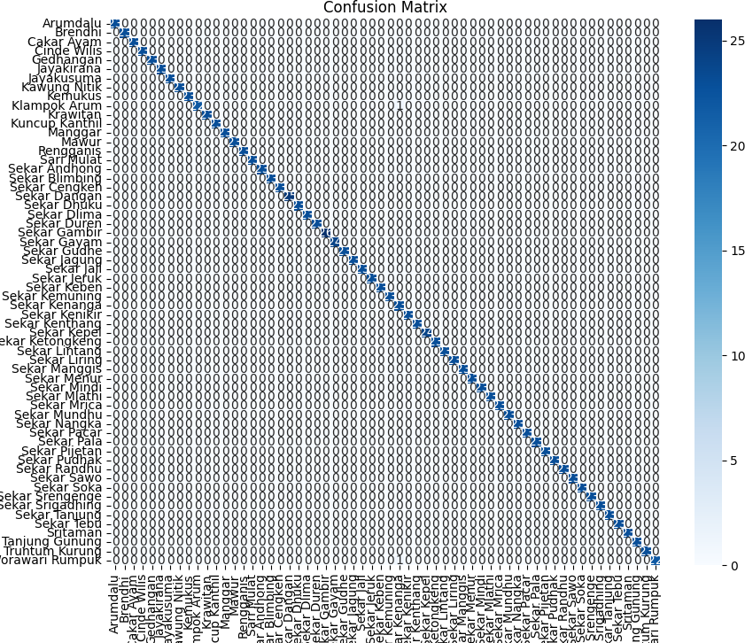

<h1 align="center">Batik Nitik Classification Model</h1>

  
  
  

A 60-class image classifier for Batik Nitik motifs, built with transfer learning from EfficientNetB0. The repository contains 16 recorded experiments.

## Best Result

`ugm_nitik_3_lr_0001.ipynb` produced the best overall result among the recorded experiments. It ties the highest test accuracy (0.9986) and F1-score (0.9986), and has the highest macro precision (0.9987).

### Evaluation Metrics

| Metric | Value |
|---|---:|
| Accuracy | 0.9986 |
| Precision (macro) | 0.9987 |
| Recall (macro) | 0.9986 |
| F1-Score (macro) | 0.9986 |
| Training time | 50.54 min |
| Model size (TFLite) | 15.59 MB |

### Accuracy Graph

### Loss Graph

### Confusion Matrix

## Model and Training

| Item | Value |
|---|---|
| Task | 60-class single-label classification |
| Backbone | EfficientNetB0, ImageNet weights, `include_top=False` |
| Input | 224 × 224 × 3 (sampled source image is 512 × 512) |
| Head | GlobalAveragePooling2D → Dropout(0.3) → Dense(60, softmax) |
| Parameters | 4,126,431 total; 4,084,408 trainable |
| Optimizer | Adam, learning rate 1e-4 |
| Loss | Categorical cross-entropy |
| Batch size | 64 train; 128 validation/test |
| Epochs | 25 configured; 15 recorded |
| Early stopping | Monitor `val_loss`, patience 3, `min_delta` 0.001, restore best weights |
| Augmentation | Rotation 90°, width/height shift 0.1, zoom 0.4, brightness 0.2–1.0, horizontal and vertical flips, nearest fill |
| Export | TensorFlow Lite, 15.59 MB |

The trained TFLite artifact is [`ugm_nitik_3_lr_0001/nitik_3_lr_0001.tflite`](ugm_nitik_3_lr_0001/nitik_3_lr_0001.tflite).

## Dataset

Source dataset: [Batik Nitik 960](https://data.mendeley.com/datasets/sgh484jxzy) by Agus Eko Minarno, Hanung Adi Nugroho, and Indah Soesanti (Mendeley Data, CC BY 4.0). The 13,496-image split below is an augmented/tiled version of the original 960 images.

The dataset contains 13,496 images across 60 Batik Nitik classes, split 75/15/10:

| Split | Images | Share |
|---|---:|---:|
| Train | 10,120 | 75% |
| Validation | 1,989 | 15% |
| Test | 1,387 | 10% |

The notebook expects the source images at `/content/drive/My Drive/Datasets/nitik960-aug-tiled-ok` and copies the split into `/content/batik/{train,validation,test}`. The dataset is not included in this repository. Images are loaded at 224 × 224.

## Repository Layout

| Path | Contents |
|---|---|
| `ugm_nitik_3_lr_0001.ipynb` | Best-performing experiment |
| `ugm_nitik_3_lr_0001/` | TFLite model, metrics report, confusion matrix, training plots |
| `ugm_nitik_*.ipynb` | Comparison experiments for augmentation, classifier width, dropout, learning rate, batch size, and fine-tuning |
| `Base/` | Baseline notebook and TFLite model |
| `Final Model/` | Final TFLite model and TFLite metadata writer |
| `Utilities/` | Dataset augmentation and copy scripts |
| `Notes/` | Experiment decisions |

 

© 2026 Ricky Fadel M. All rights reserved.
